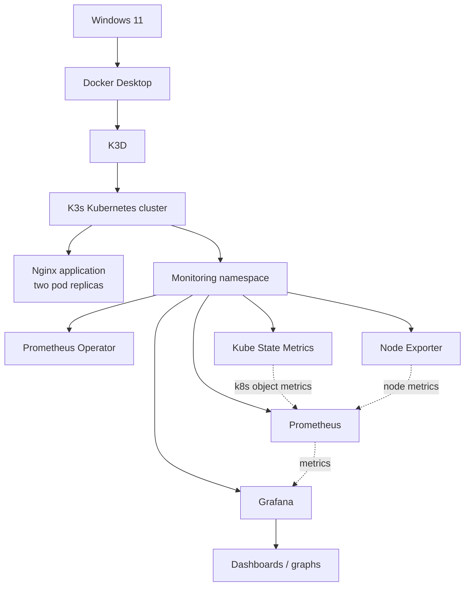

# DEVOPS / SRE — Practical Lab Guide

> **Docker Desktop → K3D → Kubernetes → Nginx → Helm → Prometheus → Grafana**


A beginner-friendly, command-by-command guide to recreate a **local Kubernetes and monitoring lab on Windows 11**. Each command includes its purpose, and every YAML file includes detailed Notepad save instructions.

---

## Table of Contents

- [Lab Environment](#lab-environment)
- [Before You Start](#before-you-start)
- [1. Install and Verify Docker Desktop](#1-install-and-verify-docker-desktop)
- [2. Install K3D](#2-install-k3d)
- [3. Create the Kubernetes Cluster](#3-create-the-kubernetes-cluster)
- [4. Deploy Nginx with Two Replicas](#4-deploy-nginx-with-two-replicas)
- [5. Install and Configure Helm](#5-install-and-configure-helm)
- [6. Add the Prometheus Helm Repository](#6-add-the-prometheus-helm-repository)
- [7. Create the Monitoring Namespace](#7-create-the-monitoring-namespace)
- [8. Create the Prometheus and Grafana Values File](#8-create-the-prometheus-and-grafana-values-file)
- [9. Download and Validate the Helm Chart](#9-download-and-validate-the-helm-chart)
- [10. Install Prometheus and Grafana](#10-install-prometheus-and-grafana)
- [11. Verify Monitoring Pods and Services](#11-verify-monitoring-pods-and-services)
- [12. Access Grafana in a Browser](#12-access-grafana-in-a-browser)
- [13. Verify the Prometheus Data Source in Grafana](#13-verify-the-prometheus-data-source-in-grafana)
- [14. Run a PromQL Query](#14-next-practical-check-run-a-promql-query)
- [15. Useful Commands for Daily Verification](#15-useful-commands-for-daily-verification)
- [16. Troubleshooting Guide](#16-troubleshooting-guide)
- [17. Lab Completion Checklist](#17-lab-completion-checklist)
- [18. Architecture Summary](#18-architecture-summary)
- [19. What to Learn Next](#19-what-to-learn-next)
- [Conclusion](#conclusion)

---

## Lab Environment

| Environment item | Lab configuration |
| --- | --- |
| Operating system | Windows 11 |
| Terminal | Windows PowerShell |
| Container platform | Docker Desktop with WSL 2 backend |
| Kubernetes tooling | K3D 5.9.0; K3s v1.35.5-k3s1 |
| Kubernetes cluster | `dev-cluster`; one server node; zero agent nodes |
| Package manager | Helm v4.3.2 |
| Monitoring | kube-prometheus-stack chart 93.9.0; Prometheus and Grafana |
| Working folder used | `C:\Users\JITENDRA REDDY` (PowerShell user profile) |

---

## Before You Start

This guide follows the setup performed in the lab. Commands are written for **Windows PowerShell**, not Linux Bash. Run commands one at a time and check the output before moving to the next step.

> ⚠️ **Important:** Keep Docker Desktop running while using K3D and Kubernetes. Do **not** stop or delete existing Docker containers that belong to other applications.

### Open PowerShell and choose a working directory

```powershell
cd "$env:USERPROFILE"
Get-Location
```

**Purpose:** moves PowerShell to your Windows user folder and prints the current directory. The YAML files in this guide are saved here for convenience. You can use another folder, but keep all related commands pointed to that folder.

---

## 1. Install and Verify Docker Desktop

### 1.1 What Docker Desktop does

Docker Desktop runs the Docker Engine on Windows and provides the Docker CLI, container runtime, networking and volume features. K3D will use Docker containers to run the local Kubernetes nodes.

### 1.2 Install Docker Desktop

1. Open <https://www.docker.com/products/docker-desktop/> in a browser.
2. Download **Docker Desktop for Windows**.
3. Run the installer. Use the **WSL 2 backend** when offered.
4. Complete installation and restart Windows if the installer requests it.
5. Open Docker Desktop and wait until it reports that the **Docker Engine is running**.

### 1.3 Verify Docker

```powershell
docker --version
docker info
docker run hello-world
```

| Command | Purpose |
| --- | --- |
| `docker --version` | Shows the installed Docker CLI version. |
| `docker info` | Shows Docker Engine details, runtime, storage and container information. |
| `docker run hello-world` | Downloads and runs a small test image to verify Docker can start containers. |

**Expected result for the test:** the output contains **"Hello from Docker!"** This confirms that Docker can download an image and run a container.

---

## 2. Install K3D

### 2.1 What K3D is

K3D is a command-line tool that creates lightweight K3s Kubernetes clusters inside Docker. Docker Desktop supplies the container runtime; K3D creates the cluster; K3s is the Kubernetes distribution running inside the cluster.

### 2.2 Install K3D with WinGet

```powershell
winget install -e --id k3d.k3d
```

**Purpose:** WinGet is the Windows package manager. The `-e` option requests an exact package ID, and `--id` identifies the K3D package.

### 2.3 Add K3D to the user PATH

In this setup, WinGet installed K3D but PowerShell did not initially find the `k3d` command. The following command adds the package folder to the user PATH and current PowerShell session.

```powershell
$k3dPath = "$env:LOCALAPPDATA\Microsoft\WinGet\Packages\k3d.k3d_Microsoft.Winget.Source_8wekyb3d8bbwe"
$userPath = [Environment]::GetEnvironmentVariable("Path", "User")

if (($userPath -split ';') -notcontains $k3dPath) {
    [Environment]::SetEnvironmentVariable("Path", "$userPath;$k3dPath", "User")
}

$env:Path += ";$k3dPath"
```

**Purpose:** `$k3dPath` stores the installation folder; the user PATH is updated permanently; `$env:Path` makes the command available in the current PowerShell window.

### 2.4 Verify K3D

```powershell
k3d version
where.exe k3d
```

The lab reported **K3D v5.9.0** and **K3s v1.35.5-k3s1**.

---

## 3. Create the Kubernetes Cluster

### 3.1 Create a one-node cluster

```powershell
k3d cluster create dev-cluster --servers 1 --agents 0
```

| Part | Meaning |
| --- | --- |
| `cluster create` | Creates a new K3D cluster. |
| `dev-cluster` | Name assigned to the cluster. |
| `--servers 1` | Creates one server/control-plane node. |
| `--agents 0` | Creates no additional agent/worker nodes. |

K3D creates Docker containers for the Kubernetes server and its supporting load balancer/tools components.

### 3.2 Verify cluster and nodes

```powershell
kubectl cluster-info
kubectl get nodes -o wide
kubectl get pods -A
```

| Command | Purpose |
| --- | --- |
| `kubectl cluster-info` | Shows the Kubernetes control-plane endpoint and cluster service information. |
| `kubectl get nodes -o wide` | Lists cluster nodes, readiness, roles, versions and IP details. |
| `kubectl get pods -A` | Lists pods in all namespaces, including Kubernetes system pods. |

**Expected node state:** the node named similar to `k3d-dev-cluster-server-0` should show `Ready`. System pods such as CoreDNS, metrics-server, local-path-provisioner and the default Traefik components should become `Running` or `Completed` as appropriate.

### 3.3 Troubleshooting the API endpoint used in this lab

The first kubeconfig endpoint in this lab used `host.docker.internal` and was unreachable from PowerShell. The K3D load balancer had published port `57716` on localhost. The port was tested and the kubeconfig endpoint was updated.

```powershell
Test-NetConnection 127.0.0.1 -Port 57716
kubectl config set-cluster k3d-dev-cluster --server=https://127.0.0.1:57716
kubectl cluster-info
kubectl get nodes
```

> ⚠️ **Port warning:** `57716` was the actual port in this lab session. A newly created cluster can use a different port. Check `docker ps` or the K3D cluster details before using this command; do not assume `57716` will always be the port.

---

## 4. Deploy Nginx with Two Replicas

A **Deployment** maintains the desired number of application pods. A **Service** gives those pods a stable network endpoint. In this lab, Nginx is deployed with two replicas and exposed through a NodePort Service.

### Create `nginx-deployment.yaml`

**Purpose:** Defines an Nginx Deployment and asks Kubernetes to keep two Nginx pods running.

1. In PowerShell, run:

    ```powershell
    notepad nginx-deployment.yaml
    ```

2. If Notepad asks whether to create the file, click **Yes**.
3. Copy the complete YAML below and paste it into Notepad. **Keep the indentation exactly as shown; use spaces, not tabs.**

    ```yaml
    apiVersion: apps/v1
    kind: Deployment
    metadata:
      name: nginx-app
    spec:
      replicas: 2
      selector:
        matchLabels:
          app: nginx
      template:
        metadata:
          labels:
            app: nginx
        spec:
          containers:
            - name: nginx
              image: nginx:latest
              ports:
                - containerPort: 80
    ```

4. Save the file using **File → Save As**:
   - **File name:** `nginx-deployment.yaml`
   - **Save as type:** `All Files (*.*)`
   - **Encoding:** `UTF-8`
   - **Save location:** `C:\Users\JITENDRA REDDY` (your Windows user folder)
   - Click **Save**. If asked to replace an existing file, confirm only if you intend to overwrite it.

5. Verify that the file exists and inspect its contents:

    ```powershell
    dir nginx-deployment.yaml
    Get-Content .\nginx-deployment.yaml
    ```

> ✅ **Check:** The filename must end in `.yaml`, not `.yaml.txt`. If it was saved incorrectly, use **Save As** again and select `All Files (*.*)`.

### 4.1 Apply the Deployment

```powershell
kubectl apply -f .\nginx-deployment.yaml
kubectl get deployments
kubectl get pods -o wide
```

**Purpose:** `kubectl apply -f` submits the YAML file to the Kubernetes API. The other commands verify the Deployment and its pods. Wait until the Deployment shows `2/2` available and both Nginx pods show `Running`.

### 4.2 Understand the Deployment YAML

| Field | Purpose |
| --- | --- |
| `apiVersion: apps/v1` | Uses the stable Kubernetes API group for Deployments. |
| `kind: Deployment` | Creates a Deployment resource. |
| `metadata.name` | Names the Deployment `nginx-app`. |
| `replicas: 2` | Requests two pod replicas. |
| `selector.matchLabels` | Tells the Deployment which pods it manages. |
| `template` | Defines the pod template Kubernetes uses to create pods. |
| `image: nginx:latest` | Uses the Nginx container image. |
| `containerPort: 80` | Documents the port on which Nginx listens inside the container. |

### Create `nginx-service.yaml`

**Purpose:** Creates a Service that selects the Nginx pods and exposes them through a NodePort.

1. In PowerShell, run:

    ```powershell
    notepad nginx-service.yaml
    ```

2. If Notepad asks whether to create the file, click **Yes**.
3. Copy the complete YAML below and paste it into Notepad. **Keep the indentation exactly as shown; use spaces, not tabs.**

    ```yaml
    apiVersion: v1
    kind: Service
    metadata:
      name: nginx-app
    spec:
      type: NodePort
      selector:
        app: nginx
      ports:
        - port: 80
          targetPort: 80
          protocol: TCP
    ```

4. Save the file using **File → Save As**:
   - **File name:** `nginx-service.yaml`
   - **Save as type:** `All Files (*.*)`
   - **Encoding:** `UTF-8`
   - **Save location:** `C:\Users\JITENDRA REDDY` (your Windows user folder)
   - Click **Save**. If asked to replace an existing file, confirm only if you intend to overwrite it.

5. Verify that the file exists and inspect its contents:

    ```powershell
    dir nginx-service.yaml
    Get-Content .\nginx-service.yaml
    ```

> ✅ **Check:** The filename must end in `.yaml`, not `.yaml.txt`. If it was saved incorrectly, use **Save As** again and select `All Files (*.*)`.

### 4.3 Apply and verify the Service

```powershell
kubectl apply -f .\nginx-service.yaml
kubectl get svc
```

The Service selector `app: nginx` must match the labels on the pods. The service port is `80` and `targetPort` is `80`. Kubernetes assigns a NodePort from its configured range.

In the lab, `kubectl get svc` showed a NodePort similar to `80:30348/TCP`. The assigned NodePort can differ in another cluster.

### 4.4 Access Nginx using port forwarding

```powershell
kubectl port-forward service/nginx-app 8080:80
```

Keep this PowerShell window open, then browse to <http://localhost:8080>. The command forwards local port `8080` to port `80` on the Kubernetes Service. Closing the port-forward process stops the temporary tunnel, but it does not delete the Deployment or Service.

> 💡 **Networking concept:** The Service selects both Nginx pods and distributes connections to available endpoints. Port forwarding is a convenient local testing method; it is not the same as exposing the application publicly.

---

## 5. Install and Configure Helm

### 5.1 What Helm does

Helm is a package manager for Kubernetes. A **Helm chart** packages Kubernetes manifests and configurable values so an application can be installed, upgraded and managed as a **release**.

### 5.2 Install Helm

```powershell
winget install -e --id Helm.Helm
```

If WinGet reports that Helm is already installed, continue with the PATH configuration and version check.

### 5.3 Add Helm to PATH

```powershell
$helmPath = "$env:LOCALAPPDATA\Microsoft\WinGet\Packages\Helm.Helm_Microsoft.Winget.Source_8wekyb3d8bbwe\windows-amd64"
$userPath = [Environment]::GetEnvironmentVariable("Path", "User")

if (($userPath -split ';') -notcontains $helmPath) {
    [Environment]::SetEnvironmentVariable("Path", "$userPath;$helmPath", "User")
}

$env:Path += ";$helmPath"
```

**Purpose:** adds the Helm executable directory to the user PATH and current PowerShell session.

### 5.4 Verify Helm

```powershell
helm version --short
where.exe helm
```

The lab reported **Helm v4.3.2+g8346aaa**. Opening a new PowerShell window usually loads the updated user PATH. If a command is still not found, check the PATH and executable location.

---

## 6. Add the Prometheus Helm Repository

A Helm repository hosts charts. We add the **Prometheus Community** repository because it provides the `kube-prometheus-stack` chart.

```powershell
helm repo add prometheus-community https://prometheus-community.github.io/helm-charts
helm repo update
helm search repo prometheus-community/kube-prometheus-stack
```

| Command | Purpose |
| --- | --- |
| `helm repo add` | Registers the chart repository with Helm. |
| `helm repo update` | Refreshes the local repository index. |
| `helm search repo` | Searches the configured repositories for the requested chart. |

The selected chart in this lab was **kube-prometheus-stack version 93.9.0**, with app version **v0.95.2**. The chart version and app version are different: the chart version identifies the Helm package; the app version identifies the main application version noted by the chart.

---

## 7. Create the Monitoring Namespace

```powershell
kubectl create namespace monitoring
kubectl get ns
```

**Purpose:** namespaces separate groups of Kubernetes resources. We use `monitoring` so the Prometheus and Grafana resources are kept together rather than mixed with the `default` namespace.

> ℹ️ **If it already exists:** If `kubectl` reports that the namespace already exists, that is not a problem. Verify it with `kubectl get ns`.

---

## 8. Create the Prometheus and Grafana Values File

The Helm values file customizes the chart. In this lab, it enables Prometheus and Grafana, disables Alertmanager, sets a short Prometheus retention period and limits resource usage for a small local machine.

### Create `prometheus-values.yaml`

**Purpose:** Configures the `kube-prometheus-stack` Helm chart, including Grafana, Prometheus, resource requests/limits and optional components.

1. In PowerShell, run:

    ```powershell
    notepad prometheus-values.yaml
    ```

2. If Notepad asks whether to create the file, click **Yes**.
3. Copy the complete YAML below and paste it into Notepad. **Keep the indentation exactly as shown; use spaces, not tabs.**

    ```yaml
    grafana:
      enabled: true
      adminPassword: "Admin@12345"
      persistence:
        enabled: false
      resources:
        requests:
          cpu: 50m
          memory: 128Mi
        limits:
          cpu: 300m
          memory: 384Mi

    prometheus:
      enabled: true
      prometheusSpec:
        replicas: 1
        retention: 2d
        scrapeInterval: 30s
        evaluationInterval: 30s
        resources:
          requests:
            cpu: 100m
            memory: 256Mi
          limits:
            cpu: 500m
            memory: 768Mi

    alertmanager:
      enabled: false

    prometheusOperator:
      resources:
        requests:
          cpu: 50m
          memory: 128Mi
        limits:
          cpu: 200m
          memory: 256Mi

    kubeStateMetrics:
      enabled: true

    nodeExporter:
      enabled: true
    ```

4. Save the file using **File → Save As**:
   - **File name:** `prometheus-values.yaml`
   - **Save as type:** `All Files (*.*)`
   - **Encoding:** `UTF-8`
   - **Save location:** `C:\Users\JITENDRA REDDY` (your Windows user folder)
   - Click **Save**. If asked to replace an existing file, confirm only if you intend to overwrite it.

5. Verify that the file exists and inspect its contents:

    ```powershell
    dir prometheus-values.yaml
    Get-Content .\prometheus-values.yaml
    ```

> ✅ **Check:** The filename must end in `.yaml`, not `.yaml.txt`. If it was saved incorrectly, use **Save As** again and select `All Files (*.*)`.

### 8.1 Understand the important values

| Configuration | Meaning |
| --- | --- |
| `grafana.enabled: true` | Enables Grafana. |
| `grafana.adminPassword` | Sets the lab Grafana admin password. Change it for any shared or production environment. |
| `grafana.persistence.enabled: false` | Disables persistent storage for Grafana in this temporary lab; dashboards or settings stored locally may be lost if the pod is recreated. |
| `prometheus.enabled: true` | Enables Prometheus. |
| `replicas: 1` | Runs one Prometheus replica. |
| `retention: 2d` | Keeps Prometheus time-series data for two days. |
| `scrapeInterval: 30s` | Sets the Prometheus scrape interval to 30 seconds. |
| `evaluationInterval: 30s` | Sets the rule evaluation interval to 30 seconds. |
| `resources.requests` | CPU and memory requested for scheduling. |
| `resources.limits` | Upper CPU and memory limits for the container. |
| `alertmanager.enabled: false` | Disables Alertmanager in this resource-conscious learning setup. |
| `kubeStateMetrics.enabled: true` | Enables Kubernetes object-state metrics. |
| `nodeExporter.enabled: true` | Enables node-level operating-system metrics. |

> ⚠️ **Security and storage:** `Admin@12345` is a simple lab password, **not a production password**. Persistence is disabled for this lab, so do not treat this as a durable production Grafana installation. Resource limits are configuration choices and may need adjustment if pods are unschedulable or repeatedly restarted.

---

## 9. Download and Validate the Helm Chart

### 9.1 Download and extract the chart

```powershell
helm pull prometheus-community/kube-prometheus-stack --version 93.9.0 --untar
```

**Purpose:** downloads the specified chart version and extracts it into a local folder named `kube-prometheus-stack`. The local folder is used for the lint command that follows.

### 9.2 Validate the chart and values

```powershell
helm lint .\kube-prometheus-stack -f .\prometheus-values.yaml
```

**Purpose:** checks the local chart and the supplied values for common chart/configuration problems. The successful result in this lab was **"1 chart(s) linted, 0 chart(s) failed."**

> 💡 **Why the first lint command failed:** `helm lint prometheus-community/kube-prometheus-stack` treated the repository reference like a local filesystem path. The folder did not exist locally. Downloading with `helm pull --untar` created the chart directory, after which `helm lint .\kube-prometheus-stack` succeeded.

---

## 10. Install Prometheus and Grafana

### 10.1 Install the chart

```powershell
helm install monitoring .\kube-prometheus-stack `
  --namespace monitoring `
  --values .\prometheus-values.yaml `
  --wait `
  --timeout 10m
```

| Argument | Purpose |
| --- | --- |
| `helm install monitoring` | Installs a Helm release named `monitoring`. |
| `.\kube-prometheus-stack` | Uses the chart folder downloaded to the current working directory. |
| `--namespace monitoring` | Creates the release in the `monitoring` namespace. |
| `--values .\prometheus-values.yaml` | Applies the custom values file. |
| `--wait` | Waits for supported resources to become ready before returning. |
| `--timeout 10m` | Allows up to ten minutes for the install operation. |

### 10.2 Verify the Helm release

```powershell
helm list -n monitoring
helm status monitoring -n monitoring
```

The lab installation returned **STATUS: `deployed`** and **DESCRIPTION: `Install complete`**.

---

## 11. Verify Monitoring Pods and Services

### 11.1 Check pods

```powershell
kubectl get pods -n monitoring
```

The lab showed these components running:

| Component | Purpose |
| --- | --- |
| Grafana | Provides dashboards and visualizes monitoring data. |
| Prometheus Operator | Manages Prometheus-related Kubernetes resources and configuration. |
| Kube State Metrics | Exposes metrics about Kubernetes objects such as pods and deployments. |
| Node Exporter | Exposes node operating-system metrics such as CPU, memory and filesystem information. |
| Prometheus | Scrapes, stores and queries time-series metrics. |

The actual lab output showed **Grafana 3/3 Running**, **Prometheus Operator 1/1 Running**, **Kube State Metrics 1/1 Running**, **Node Exporter 1/1 Running**, and the **Prometheus pod 2/2 Running**. A restart count can occur during startup; investigate only if restarts continue or the pod is unhealthy.

### 11.2 Check services

```powershell
kubectl get svc -n monitoring
```

**Purpose:** lists Services created by the monitoring chart. Grafana and Prometheus are reachable internally through Kubernetes Service DNS names.

---

## 12. Access Grafana in a Browser

### 12.1 Start port forwarding

```powershell
kubectl port-forward svc/monitoring-grafana 3000:80 -n monitoring
```

**Purpose:** maps localhost port `3000` to port `80` on the Grafana Service in the `monitoring` namespace. Keep this PowerShell window open while using Grafana.

### 12.2 Open Grafana and log in

- Open <http://localhost:3000> in your browser.
- **Username:** `admin`
- **Password:** `Admin@12345` (the password configured in the values file).

The lab user successfully logged in to Grafana.

> 💡 **Port forwarding:** If you close the PowerShell window or stop the command, the local forwarding tunnel stops. The Grafana pod and Service continue running in Kubernetes.

---

## 13. Verify the Prometheus Data Source in Grafana

Grafana uses **data sources** to retrieve information. Prometheus is the metrics data source for this lab.

### 13.1 Find the data source

1. In Grafana, open **Connections**.
2. Select **Data sources**.
3. Open the **Prometheus** data source.

The data source is provisioned automatically by `kube-prometheus-stack`. Grafana may display a message saying it was added by configuration and cannot be modified through the UI. This is expected for a chart-provisioned data source; it does not mean the connection is broken.

The usual in-cluster Prometheus service address for this release is:

```text
http://monitoring-kube-prometheus-prometheus.monitoring:9090/
```

Do **not** change a provisioned data source through the UI. The configuration is managed by the Helm chart.

---

## 14. Next Practical Check: Run a PromQL Query

The user reached Grafana Explore, but the query itself had not yet been confirmed as successful. Use this as the next exercise.

1. In Grafana, open **Explore** from the left navigation.
2. Select **Prometheus** as the data source.
3. In the query row, switch from **Builder** to **Code** mode (the exact toggle placement can vary by Grafana version).
4. Enter the PromQL expression shown below.
5. Click **Run queries**.

```promql
up
```

**Expected result:** Prometheus returns a set of scrape targets. A value of `1` means a target is up; a value of `0` means a target is down. The exact number of returned series depends on the components discovered by Prometheus.

> ℹ️ **If Code mode is not visible:** Look for the Builder/Code switch in the query editor. If the interface differs, use a screenshot of the Explore page to identify the correct control.

---

## 15. Useful Commands for Daily Verification

| Command | Purpose |
| --- | --- |
| `docker ps` | Lists running Docker containers, including K3D node containers. |
| `docker images` | Lists locally downloaded container images. |
| `k3d cluster list` | Lists K3D clusters. |
| `kubectl cluster-info` | Shows Kubernetes cluster endpoint information. |
| `kubectl get nodes -o wide` | Shows node readiness and details. |
| `kubectl get pods -A` | Lists pods in all namespaces. |
| `kubectl get pods -n monitoring` | Checks monitoring pods. |
| `kubectl get svc -n monitoring` | Lists monitoring Services. |
| `kubectl get deployments -n monitoring` | Lists monitoring Deployments. |
| `kubectl describe pod POD_NAME -n monitoring` | Shows detailed pod events and configuration. |
| `kubectl logs POD_NAME -n monitoring` | Displays logs from a pod's default container. |
| `kubectl logs POD_NAME -c CONTAINER_NAME -n monitoring` | Displays logs from a specific container in a multi-container pod. |
| `helm list -A` | Lists Helm releases in all namespaces. |
| `helm status monitoring -n monitoring` | Shows details of the `monitoring` Helm release. |
| `helm repo list` | Lists configured Helm repositories. |
| `helm repo update` | Refreshes Helm repository indexes. |

---

## 16. Troubleshooting Guide

### 16.1 Docker command is not recognized

Confirm Docker Desktop is installed and running. Open a new PowerShell window, then run:

```powershell
docker --version
docker info
```

### 16.2 K3D or Helm command is not recognized

Confirm the executable exists in the WinGet package directory and that the directory is included in the user PATH. Open a new PowerShell window after changing PATH. Use `where.exe k3d` or `where.exe helm` to inspect command resolution.

### 16.3 kubectl cannot connect to the cluster

```powershell
docker ps
k3d cluster list
kubectl config current-context
kubectl get nodes
```

Confirm Docker Desktop is running and the K3D server/load-balancer containers are up. If the API endpoint is incorrect, inspect the current published port before updating kubeconfig.

### 16.4 Pod is Pending, CrashLoopBackOff or not Ready

```powershell
kubectl get pods -n monitoring
kubectl describe pod POD_NAME -n monitoring
kubectl logs POD_NAME -n monitoring
```

Replace `POD_NAME` with the actual pod name. Use `describe` to inspect events and `logs` to inspect application output. If a pod has multiple containers, specify the container with `-c`.

### 16.5 Grafana page does not open

```powershell
kubectl get pods -n monitoring
kubectl get svc monitoring-grafana -n monitoring
```

Check that the Grafana pod is **Ready**, then confirm the port-forward command is still running in PowerShell. Browse to <http://localhost:3000>.

### 16.6 YAML file is not found

```powershell
Get-Location
dir *.yaml
```

PowerShell must be in the folder where the file was saved. If needed, change directory with `cd` and run the command again. Check that Notepad did not append `.txt` to the filename.

---

## 17. Lab Completion Checklist

| Activity | Lab status |
| --- | --- |
| Docker Desktop installed and Docker Engine running | ✅ Completed |
| K3D installed and available in PATH | ✅ Completed |
| `dev-cluster` created | ✅ Completed |
| Kubernetes node reports `Ready` | ✅ Completed |
| Nginx Deployment with two replicas created | ✅ Completed |
| Nginx Service created and tested through port-forward | ✅ Completed |
| Helm installed and available in PATH | ✅ Completed |
| Prometheus Community Helm repository added | ✅ Completed |
| `monitoring` namespace created | ✅ Completed |
| `prometheus-values.yaml` created and saved | ✅ Completed |
| Helm chart downloaded and lint passed | ✅ Completed |
| `kube-prometheus-stack` installed | ✅ Completed |
| Monitoring pods verified `Running` | ✅ Completed |
| Grafana opened and login successful | ✅ Completed |
| Prometheus data source visible in Grafana | ✅ Completed |
| PromQL `up` query executed and verified | ⏳ Next activity / not yet confirmed |

---

## 18. Architecture Summary

The following describes the main flow of the local lab:

```text
Windows 11
   |
   v
Docker Desktop
   |
   v
K3D
   |
   v
K3s Kubernetes cluster
   |
   +---------------------------+
   |                           |
   v                           v
Nginx application          Monitoring namespace
(two pod replicas)              |
                               +--> Prometheus Operator
                               +--> Kube State Metrics
                               +--> Node Exporter
                               +--> Prometheus
                               +--> Grafana
                                        |
                                        v
                                 Dashboards / graphs
```

**Mermaid version** (renders on GitHub):



**Prometheus** collects and stores metrics. **Grafana** queries Prometheus and displays those metrics in dashboards. **Kube State Metrics** provides information about Kubernetes objects, while **Node Exporter** provides node-level metrics.

---

## 19. What to Learn Next

1. **PromQL:** practice queries such as `up`, `rate()`, `sum()`, and resource-specific queries.
2. **Kubernetes dashboards:** inspect cluster, namespace, pod and node CPU/memory panels.
3. **Loki:** install a log aggregation backend for Kubernetes and application logs.
4. **Grafana Alloy:** collect and forward logs to Loki (use Alloy rather than starting a new Promtail deployment).
5. **Observability:** correlate metrics, logs and traces, and learn alerting concepts.

---

## Conclusion

The lab successfully established a local Kubernetes environment on Windows 11 using **Docker Desktop** and **K3D**. An **Nginx** application was deployed with two replicas and exposed through a Kubernetes Service. **Helm** was used to install **kube-prometheus-stack**, which provided Prometheus, Grafana, Prometheus Operator, Node Exporter and Kube State Metrics. Grafana login was successful and the Prometheus data source was visible as an automatically provisioned source. Running and verifying a PromQL query is the next practical exercise.

> ⚠️ **Production reminder:** This is a **local learning environment**. The lab password, disabled Grafana persistence, short Prometheus retention and single-node cluster are **not production-ready settings**.

---

**Docker Desktop** • **K3D** • **Kubernetes** • **Helm** • **Prometheus** • **Grafana**
